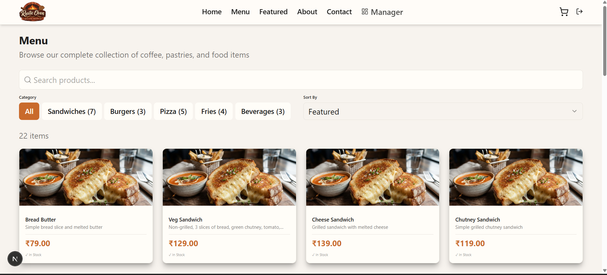
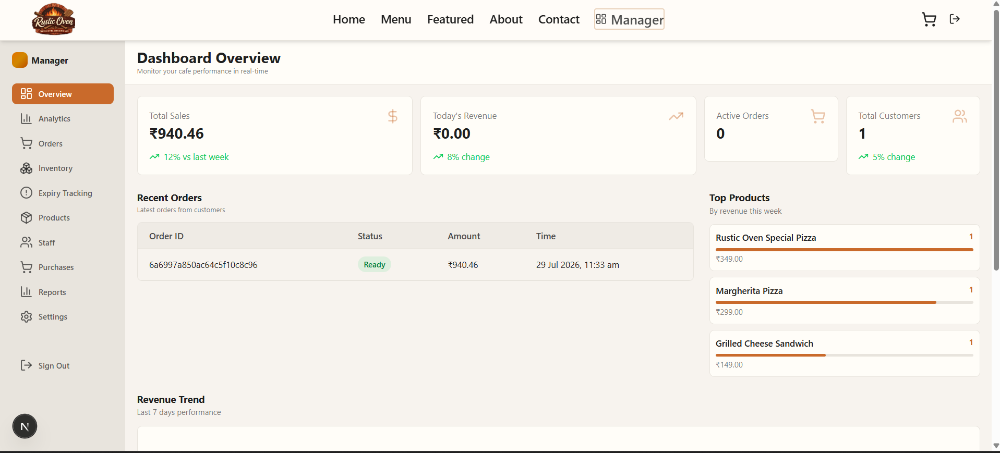

# 🍕 Rustic Oven — Full-Stack Restaurant Ordering & Management Platform

A full-stack web app for a wood-fired restaurant: a public ordering site for customers and a complete operations dashboard for managers — menu, orders, inventory, staff, purchases, and analytics — all backed by a real database.

<!-- Screenshots -->




## Live Demo

<!-- Add your deployed URL here once hosted, e.g.: https://rustic-oven.vercel.app -->

## Features

**Customer-facing**
- Browse the full menu with search, category filters, and sorting
- Product detail pages with real photography
- Shopping cart and checkout flow
- Customer account with order history

**Manager dashboard**
- Live sales overview with revenue and order trends
- Order management with status updates (pending → preparing → ready → delivered)
- Product catalog CRUD (create, edit, delete menu items)
- Inventory & expiry tracking for pantry ingredients
- Staff management
- Purchase logging (incoming stock)
- Sales reports and analytics

Fully responsive across mobile, tablet, and desktop.

## Tech Stack

**Frontend**
- [Next.js](https://nextjs.org/) 16 (App Router) + React 19
- Tailwind CSS 4
- [@base-ui/react](https://base-ui.com/) for accessible, styled components (dropdowns, etc.)
- Lucide icons

**Backend**
- [FastAPI](https://fastapi.tiangolo.com/) (Python)
- [MongoDB](https://www.mongodb.com/) via Motor (async driver)
- JWT-based authentication, bcrypt password hashing

## Project Structure

```
RusticOven/
├── frontend/          Next.js app (customer site + manager dashboard)
│   ├── app/             Pages (App Router)
│   ├── components/      Shared UI components
│   ├── lib/              Utilities, formatting, product-image mapping
│   └── services/          API client functions
└── backend/            FastAPI app
    ├── main.py           App entrypoint
    ├── routes/            API route handlers
    ├── models.py          Pydantic schemas
    ├── database.py        MongoDB connection
    └── seed_*.py          Scripts to seed sample data
```

## Running Locally

Requires Node.js 18+, Python 3.10+, and a local or Atlas MongoDB instance.

**1. Backend**
```bash
cd backend
python -m venv venv
venv\Scripts\activate          # Windows
# source venv/bin/activate     # macOS/Linux
pip install -r requirements.txt

# Create backend/.env from backend/.env.example and set:
#   MONGO_URI=mongodb://localhost:27017
#   DB_NAME=cafe_db
#   JWT_SECRET=<any long random string>

uvicorn backend.main:app --reload
```
Runs at `http://localhost:8000` (interactive API docs at `/docs`).

**2. Seed sample data** (from the project root, in a second terminal)
```bash
python -m backend.seed_data
python -m backend.seed_admin
python -m backend.seed_staff
python -m backend.seed_tables
```
Creates a manager login: `dubale@admin.com` / `Admin@123`

**3. Frontend**
```bash
cd frontend
npm install
npm run dev
```
Runs at `http://localhost:3000`.

## License

This project is for portfolio/demonstration purposes.
